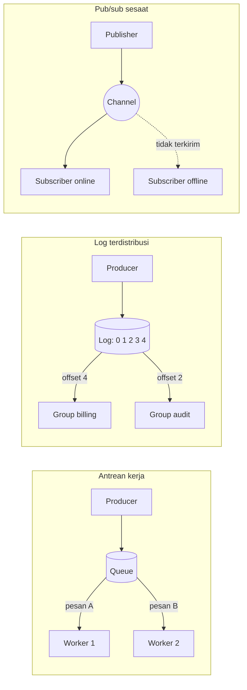

# Perbandingan RabbitMQ, Kafka, dan Redis untuk Messaging

Dokumen ini menjawab pertanyaan yang sering muncul setelah pelatihan RabbitMQ
dan Kafka: kapan memakai RabbitMQ, kapan Kafka, kapan Redis, dan kapan cukup
tabel Postgres. Bagian akhir merangkum alternatif lain yang mungkin kalian
temui di instansi atau vendor.

Acuan versi: RabbitMQ 4.4, Apache Kafka 4.4, Redis 8.x dan Valkey 9.x, per
November 2026. Banyak detail di sini berubah antarversi; sumber resmi tercantum
di bagian akhir. Dokumen ini sengaja tidak memuat angka benchmark. Throughput
dan latensi sangat bergantung pada ukuran pesan, persistensi, replikasi, dan
perangkat keras, jadi ukur sendiri dengan beban kalian.

## 1. Tiga model dasar

Ketiga teknologi ini sering disebut "message broker", padahal model kerjanya
berbeda. Perbandingan baru masuk akal setelah modelnya dipisahkan.

**Antrean kerja (work queue / message queue).** Producer menaruh pesan di
antrean. Setiap pesan diambil oleh satu worker, lalu dihapus setelah worker
mengirim ack. Broker melacak status per pesan: belum dikirim, sedang diproses,
selesai. Cocok untuk membagi pekerjaan ke banyak worker.

**Log terdistribusi (event streaming).** Producer menambahkan record ke log
yang hanya bisa ditambah di ujung (append-only). Record tidak hilang saat
dibaca. Setiap consumer group menyimpan posisinya sendiri (offset), jadi banyak
pembaca bisa membaca data yang sama dengan kecepatan masing-masing, dan bisa
mundur untuk replay selama data masih dalam periode retention.

**Pub/sub sesaat.** Pesan diteruskan ke subscriber yang sedang terhubung saat
itu, lalu dilupakan. Tidak ada penyimpanan, tidak ada ack. Subscriber yang
sedang mati tidak akan menerima pesan yang lewat.

Masing-masing teknologi punya beberapa mode yang jatuh ke model berbeda:

| Teknologi dan mode | Model utama |
|---|---|
| RabbitMQ classic queue, quorum queue | Antrean kerja |
| RabbitMQ stream, super stream | Log terdistribusi |
| RabbitMQ exchange tanpa queue durable (mis. queue sementara per subscriber) | Mendekati pub/sub sesaat |
| Kafka topic + consumer group | Log terdistribusi |
| Kafka topic + share group (KIP-932) | Antrean kerja di atas log |
| Redis List (`LPUSH` + `BRPOP`/`BLMOVE`) | Antrean kerja sederhana |
| Redis Pub/Sub | Pub/sub sesaat |
| Redis Streams + consumer group | Log terdistribusi berukuran terbatas memori |

## 2. Mode tiap teknologi secara singkat

### RabbitMQ 4.x

Producer mengirim ke **exchange**, lalu exchange merutekan ke queue lewat
**binding**. Tipe exchange: `direct` (cocok persis dengan routing key),
`topic` (pola dengan wildcard `*` dan `#`), `fanout` (ke semua queue yang
terikat), dan `headers`. Routing fleksibel di sisi broker adalah kekuatan utama
RabbitMQ.

Tipe queue:

- **Classic queue.** Sejak 4.0, mirroring classic queue dihapus total. Classic
  queue sekarang tidak direplikasi: hanya ada satu salinan di satu node.
- **Quorum queue.** Direplikasi dengan algoritme Raft ke beberapa node; pilihan
  untuk data yang tidak boleh hilang. Sejak 4.0 ada `delivery-limit` default 20
  dan dukungan prioritas. Sejak 4.3, hitungan pengiriman hanya naik untuk
  kegagalan sungguhan (`reject`, koneksi putus), bukan untuk `nack` biasa.
- **Stream.** Log append-only yang direplikasi. Pesan tidak dihapus saat
  dibaca; consumer memilih posisi mulai lewat offset. Retention diatur dengan
  `max-age` atau `max-length-bytes`. **Super stream** membagi satu stream logis
  ke beberapa partisi, mirip partisi Kafka, dan dipadukan dengan single active
  consumer agar urutan per partisi terjaga.

Sejak 4.0, AMQP 1.0 menjadi protokol inti yang selalu aktif, di samping AMQP
0-9-1 yang dipakai kebanyakan klien Node.js.

### Kafka 4.x

Data disimpan di **topic** yang dibagi ke **partisi**. Setiap partisi adalah
log berurutan yang direplikasi (lihat Lab 01). Consumer bergabung dalam
**consumer group**: setiap partisi dipegang oleh tepat satu consumer di group
itu, dan position consumer disimpan sebagai offset (Lab 04). Sejak 4.0 Kafka hanya
berjalan dalam mode KRaft; ZooKeeper sudah dihapus.

**Share group** (KIP-932, "Queues for Kafka") adalah jenis group baru. Beberapa
consumer bisa membaca partisi yang sama bersama-sama, setiap record di-ack satu
per satu (accept, release, reject, dan sejak 4.2 renew untuk memperpanjang
waktu proses), dan broker menghitung jumlah percobaan pengiriman. Statusnya:
early access di 4.0, preview di 4.1, **production-ready sejak 4.2**. Di 4.4,
share group mendapat dukungan dead-letter queue (KIP-1191), aktif setelah fitur
`share.version` dinaikkan ke 2. Share group tidak menjaga urutan per partisi,
jadi cocok untuk pekerjaan yang diproses satu per satu, bukan aliran yang
urutannya penting.

Catatan untuk Node.js: per changelog `@confluentinc/kafka-javascript` 1.11.0
belum ada dukungan share consumer, dan dokumentasi Confluent menyebut share
consumer baru tersedia untuk klien Java. `kafkajs` (dipakai NestJS) juga tidak
punya. Jadi share group belum bisa dipakai langsung dari stack lab ini.

### Redis 8 dan Valkey

Redis menyediakan tiga mekanisme yang sering disebut "queue":

- **List** dengan `LPUSH` dan `BRPOP`. Sederhana dan cepat, tapi tidak ada ack:
  begitu pesan di-pop, broker menganggapnya selesai. Pola yang lebih aman
  memakai `BLMOVE` untuk memindahkan pesan ke list "sedang diproses", lalu
  menghapusnya setelah selesai. Pemulihan pesan yang tertinggal di list itu
  harus ditulis sendiri.
- **Pub/Sub.** Dokumentasi Redis menyebutnya at-most-once: kalau subscriber
  sedang terputus atau gagal memproses, pesan hilang.
- **Streams.** Log append-only dengan consumer group, ack (`XACK`), daftar
  pesan yang belum di-ack (pending entries list), dan `XAUTOCLAIM` untuk
  mengambil alih pesan yang macet di consumer lain. Panjang stream dibatasi
  dengan `MAXLEN` atau `MINID`. Sejak Redis 8.2, trimming bisa diatur agar hanya
  membuang entri yang sudah di-ack semua group (`ACKED`).

Di atas Redis ada pustaka antrean seperti **BullMQ** (lisensi MIT, ada modul
`@nestjs/bullmq`). BullMQ menyediakan retry dengan backoff, job tertunda,
prioritas, rate limit, dan antarmuka worker yang rapi. Menurut dokumentasinya,
BullMQ berjalan di Redis, server yang kompatibel seperti Valkey dan Dragonfly,
dan kini juga PostgreSQL.

Lisensi: Redis 8 ke atas tersedia dengan tiga pilihan lisensi, RSALv2, SSPLv1,
atau AGPLv3; hanya AGPLv3 yang berstatus open source menurut OSI. Redis 7.2 ke
bawah tetap BSD-3. **Valkey** adalah fork Redis 7.2.4 di bawah Linux Foundation
dengan lisensi BSD-3 dan protokol yang kompatibel; versi stabil terbaru saat
dokumen ini ditulis adalah 9.1.x. Untuk keperluan messaging, perintah List,
Pub/Sub, dan Streams dasar sama di keduanya. Fitur Redis 8.x yang lebih baru
belum tentu ada di Valkey, jadi cek dulu kalau kalian memakainya.

## 3. Perbandingan per kriteria

| Kriteria | RabbitMQ 4.x | Kafka 4.x | Redis 8 / Valkey |
|---|---|---|---|
| Model dan routing | Antrean kerja dengan routing kaya di broker (exchange, binding, pola topic, header). Stream untuk model log. | Log berpartisi. Routing sederhana: producer memilih topic, key menentukan partisi. Penyaringan dilakukan consumer. | List dan Streams per key; Pub/Sub per channel atau pola. Tidak ada routing di broker selain nama key/channel. |
| Urutan pesan | FIFO per queue. Dengan banyak consumer, prefetch, atau requeue, urutan proses tidak terjamin. Single active consumer menjaga urutan dengan mengorbankan paralelisme. | Terjamin per partisi. Pesan dengan key sama masuk partisi sama (Lab 02). Tidak ada urutan global antarpartisi. Share group tidak menjaga urutan. | List dan Streams berurutan per key. Dengan banyak consumer di satu group, urutan proses tidak terjamin. |
| Retention dan replay | Queue: pesan hilang setelah di-ack, tidak ada replay. Stream: retention berbasis umur atau ukuran, bisa dibaca ulang dari offset. | Retention berbasis waktu atau ukuran (default 7 hari), atau compaction per key. Replay dengan reset offset (Lab 04, Lab 06). | List: tidak ada replay. Pub/Sub: tidak ada penyimpanan. Streams: bisa dibaca ulang dengan `XRANGE` atau mengatur ulang ID group, tapi panjangnya dibatasi memori. |
| Jaminan dan durabilitas saat node mati | Quorum queue dan stream direplikasi; dengan publisher confirm, pesan aman selama mayoritas replika hidup. Classic queue tidak direplikasi: kalau node-nya mati, queue tidak tersedia sampai node kembali. | Replikasi per partisi. Dengan `acks=all` dan `min.insync.replicas=2`, tulisan yang sudah di-ack bertahan walau satu broker mati (Lab 01). At-least-once secara default; idempotent producer dan transaksi untuk kasus tertentu. | Data di memori, persistensi lewat RDB atau AOF sesuai konfigurasi. Replikasi asinkron: saat failover, tulisan yang sudah dikonfirmasi ke klien bisa hilang. Pub/Sub at-most-once. |
| Skala consumer | Tambah consumer di queue yang sama; batasnya kapasitas satu queue di satu leader. Untuk skala lebih, pecah ke beberapa queue atau super stream. | Consumer aktif per group maksimal sejumlah partisi. Share group melepas batas ini untuk pola antrean. | Streams: tambah consumer di group. Satu stream ada di satu shard Redis Cluster, jadi skala horizontal berarti memecah ke beberapa key. |
| Retry dan DLQ bawaan | Ada: dead-letter exchange, `delivery-limit` di quorum queue, TTL. Dokumentasi quorum queue terbaru juga memuat delayed retry; cek versi minimalnya sebelum dipakai. | Consumer group: tidak ada; retry topic dan DLT dibuat di aplikasi (Lab 06). Share group: hitungan percobaan dan DLQ bawaan (4.4, `share.version=2`). | List, Pub/Sub, Streams: tidak ada; Streams hanya memberi hitungan pengiriman di pending list. BullMQ menyediakan retry dan penyimpanan job gagal. |
| Beban operasional | Satu sistem dengan UI manajemen bawaan. Quorum queue butuh minimal 3 node. Perlu memantau panjang queue, alarm memori dan disk. | Lebih banyak yang harus direncanakan: jumlah partisi, retention dan kapasitas disk, rebalance, dan sering ditambah Schema Registry serta Connect. KRaft menghapus kebutuhan ZooKeeper. | Paling ringan kalau Redis sudah ada. Begitu dipakai sebagai antrean, persistensi, `maxmemory-policy noeviction`, dan HA (Sentinel atau Cluster) wajib diatur, dan sering bentrok dengan kebutuhan cache. |
| Klien Node.js / NestJS | `amqplib`, `rabbitmq-client`; `rabbitmq-stream-js-client` untuk stream. NestJS punya transport RabbitMQ bawaan. | `@confluentinc/kafka-javascript` (berbasis librdkafka, API kompatibel KafkaJS) dipakai di lab. Transport Kafka NestJS berjalan di atas `kafkajs`, yang rilis terakhirnya 2.2.4 (Februari 2023). | `ioredis`, `redis` (node-redis), BullMQ + `@nestjs/bullmq`. Transport Redis bawaan NestJS memakai Pub/Sub, jadi at-most-once. |
| Lisensi server | MPL 2.0 | Apache 2.0 | Redis 8: RSALv2 / SSPLv1 / AGPLv3 (pilih satu). Valkey: BSD-3. |

## 4. Kelemahan masing-masing

### RabbitMQ

- Tidak dirancang untuk menyimpan data lama. Queue yang menumpuk memakan memori
  dan disk, dan alarm sumber daya akan menahan publisher. Stream mengatasi ini
  untuk pola log, tapi klien dan semantiknya berbeda dari queue biasa.
- Replay tidak tersedia di queue biasa. Kalau butuh audit atau membangun ulang
  read model, harus memakai stream atau menyimpan sendiri.
- Classic queue tidak lagi punya replikasi. Tim yang dulu mengandalkan mirrored
  queue harus pindah ke quorum queue, yang punya karakteristik berbeda (misalnya
  batas pengiriman default 20).
- Urutan dan paralelisme saling tarik. Menjaga urutan ketat berarti satu
  consumer aktif per queue.

### Kafka

- Tidak ada routing di broker. Penyaringan dan pemilahan dilakukan consumer
  atau lewat topic terpisah, sehingga jumlah topic bisa bertambah banyak.
- Paralelisme consumer group dibatasi jumlah partisi, dan partisi tidak bisa
  dikurangi setelah dibuat. Menambah partisi mengubah pemetaan key ke partisi.
- Tidak ada retry, delay, atau DLQ bawaan di consumer group. Pola-pola itu
  harus dibangun di aplikasi (Lab 06), dan pesan yang gagal di tengah partisi
  bisa menahan pesan di belakangnya.
- Per-pesan ack, prioritas, dan pesan tertunda bukan bagian model log. Share
  group menambah ack per record, tapi dukungan di klien Node.js belum ada.
- Biaya operasional lebih tinggi: perencanaan kapasitas disk dan partisi,
  rebalance, dan komponen pendamping. Untuk beban kecil, Kafka sering lebih
  berat daripada masalah yang ingin diselesaikan.
- Di NestJS, transport Kafka masih bergantung pada `kafkajs` yang sudah lama
  tidak dirilis ulang.

### Redis

- Data dibatasi memori. Antrean yang menumpuk bersaing dengan cache di instance
  yang sama, dan kebijakan eviction yang cocok untuk cache bisa membuang key
  antrean. BullMQ secara eksplisit mensyaratkan `noeviction`.
- Replikasi asinkron. Redis bukan pilihan untuk pesan yang tidak boleh hilang
  sama sekali saat failover.
- List tanpa ack kehilangan pesan kalau worker mati setelah pop. Pub/Sub
  kehilangan pesan kalau subscriber sedang terputus.
- Streams tidak punya DLQ, retry tertunda, atau retention berbasis waktu bawaan;
  semua itu ditulis sendiri atau diserahkan ke pustaka.
- Lisensi Redis berubah dua kali dalam dua tahun. Untuk instansi yang punya
  kebijakan lisensi, ini perlu dicek, atau pertimbangkan Valkey.

## 5. Panduan memilih

Mulailah dari model yang dibutuhkan, baru dari teknologi yang sudah dimiliki
tim. Teknologi yang sudah dioperasikan dengan baik sering lebih berharga
daripada teknologi yang secara teori lebih cocok.

| Skenario | Pilihan yang masuk akal | Alasan |
|---|---|---|
| Job background di satu aplikasi (kirim email, buat PDF, resize gambar) | BullMQ di Redis, atau RabbitMQ quorum queue | Butuh retry, delay, dan worker paralel; replay jarang dibutuhkan. BullMQ cukup kalau Redis sudah ada dan job boleh diulang. RabbitMQ lebih tepat kalau job harus bertahan saat node mati. |
| Notifikasi ke pengguna (email, SMS, push) dari beberapa sumber | RabbitMQ dengan exchange `topic` atau `fanout` | Satu event perlu dirutekan ke beberapa kanal dengan aturan berbeda; routing di broker membuat ini mudah. Kafka juga bisa, dengan satu consumer group per kanal. |
| Integrasi antar-service yang butuh replay dan audit | Kafka | Event disimpan selama periode retention, banyak service membaca dengan offset sendiri, service baru bisa membaca dari awal. Ini skenario lab training ini. RabbitMQ stream adalah alternatif kalau tim sudah memakai RabbitMQ dan volumenya sedang. |
| CDC dari database | Kafka + Debezium | Ekosistem konektor Debezium dan Kafka Connect paling matang di sini (lihat demo `demo/debezium`). Debezium Server juga bisa mengirim ke tujuan lain, termasuk Redis dan beberapa layanan cloud, untuk kasus yang lebih kecil. |
| Invalidasi cache di banyak instance aplikasi | Redis Pub/Sub | Pesan kecil, harus cepat, dan kehilangan sesekali bisa diterima karena cache tetap punya TTL. Kalau tidak boleh terlewat, pakai Redis Streams atau topic Kafka yang dibaca setiap instance. |
| Request-reply antar-service | HTTP atau gRPC dulu; RabbitMQ kalau memang perlu lewat broker | Messaging asinkron menambah kompleksitas untuk pola yang pada dasarnya sinkron. RabbitMQ punya dukungan reply-to yang mapan; Kafka kurang cocok untuk pola ini. |
| Antrean dengan prioritas atau penundaan per pesan | RabbitMQ atau BullMQ | Kafka tidak punya prioritas atau delay per pesan di model log. |
| Volume event tinggi dengan banyak pembaca berbeda (log aktivitas, telemetri bisnis) | Kafka | Satu salinan data dibaca banyak group tanpa menggandakan pesan di broker. |

### Memakai dua sekaligus

Kombinasi yang wajar dan sering ditemui:

- **Kafka untuk event bisnis antar-service, RabbitMQ atau BullMQ untuk job di
  dalam service.** Contoh: `payment-service` membaca `order.created.v1` dari
  Kafka, lalu menaruh job "kirim bukti bayar" ke antrean lokal yang punya retry
  dan delay.
- **Kafka untuk data, Redis untuk sinyal.** Event tetap di Kafka; Redis Pub/Sub
  hanya memberi tahu instance lain bahwa cache perlu diperbarui.

Setiap broker tambahan berarti satu sistem lagi untuk dipantau, di-upgrade,
dan diamankan. Tambahkan hanya kalau kebutuhannya jelas berbeda.

### Kapan cukup tabel Postgres

Untuk banyak aplikasi di satu database, tabel biasa sudah cukup:

- **Antrean di tabel** dengan `SELECT ... FOR UPDATE SKIP LOCKED`. Beberapa
  worker bisa mengambil baris berbeda tanpa saling menunggu, dan job ditulis
  dalam transaksi yang sama dengan data bisnis. Cocok untuk volume sedang dan
  tim yang belum punya broker.
- **Outbox.** Baris bisnis dan baris outbox ditulis dalam satu transaksi, lalu
  publisher membaca outbox dengan `FOR UPDATE SKIP LOCKED` dan mengirim ke
  broker. Pola ini sudah dipakai di Lab 07 dan menyelesaikan masalah "DB dan
  broker harus berubah bersama". Outbox melengkapi broker, bukan
  menggantikannya.

Batasnya: polling menambah beban ke database utama, tidak ada fan-out ke
banyak pembaca tanpa desain tambahan, dan tabel antrean perlu dibersihkan
rutin. Kalau beberapa service berbeda mulai membaca antrean yang sama, itu
tanda untuk pindah ke broker.

## 6. Alternatif lain

### Broker open source lain

- **NATS dan JetStream.** NATS inti adalah pub/sub ringan tanpa penyimpanan;
  JetStream menambahkan stream yang persisten, consumer dengan ack, dan mode
  antrean kerja. Proyek CNCF berlisensi Apache 2.0; sengketa antara CNCF dan
  Synadia pada 2025 berakhir dengan NATS tetap di CNCF dengan lisensi yang sama.
- **Apache Pulsar.** Memisahkan broker (penyajian) dari penyimpanan (Apache
  BookKeeper), mendukung model log dan antrean dalam satu sistem lewat beberapa
  jenis subscription, serta tiered storage. Lebih banyak komponen untuk
  dioperasikan dibanding Kafka.
- **Apache Artemis** (sebelumnya ActiveMQ Artemis). Sejak Desember 2025 menjadi
  top-level project Apache tersendiri, terpisah dari ActiveMQ. Broker gaya JMS
  yang mendukung AMQP, MQTT, STOMP, dan OpenWire; pilihan wajar di lingkungan
  Java/Jakarta EE.

### Broker enterprise komersial

Kelompok ini umum di perbankan, transportasi, telekomunikasi, dan instansi
dengan sistem lama: **IBM MQ**, **TIBCO EMS**, dan **Solace**. Ciri umumnya:
dukungan vendor, sertifikasi, alat administrasi lengkap, sering tersedia dalam
bentuk appliance, dan biaya lisensi. Dari sisi aplikasi Node.js, integrasi
biasanya lewat protokol terbuka (AMQP, MQTT, JMS bridge, REST) atau klien
milik vendor.

**Solace** perlu dibahas sedikit lebih rinci karena modelnya berbeda dari
RabbitMQ dan Kafka:

- **Nama produk.** Solace sedang mengganti merek "PubSub+" menjadi "Solace".
  Solace PubSub+ Event Broker kini disebut Solace Event Broker, tersedia sebagai
  software, appliance, dan layanan cloud (Solace Cloud). Dokumen lama masih
  memakai nama PubSub+.
- **Topic hierarkis.** Topic berbentuk string bertingkat seperti
  `order/created/v1/jakarta`, dan subscriber subscribe dengan wildcard: `*`
  untuk satu tingkat dan `>` untuk satu tingkat atau lebih di ujung. Topic
  dipakai langsung sebagai informasi routing; tidak perlu membuat topic lebih
  dulu seperti di Kafka.
- **Dua mode pengiriman.** Direct messaging untuk volume tinggi dan latensi
  rendah yang bisa menerima kehilangan sesekali (tanpa penyimpanan, tanpa ack).
  Guaranteed messaging menyimpan pesan di queue atau endpoint di broker dengan
  ack, untuk data yang tidak boleh hilang. Fitur message replay tersedia.
- **Event mesh.** Dengan Dynamic Message Routing (DMR), beberapa broker
  disambungkan dalam satu situs atau antarsitus dan saling bertukar informasi
  langganan. Pesan dirutekan otomatis ke broker tempat subscriber berada, tanpa
  aplikasi perlu tahu topologi jaringannya. Ini kekuatan khas Solace untuk
  organisasi dengan banyak lokasi atau campuran on-premise dan cloud.
- **Protokol.** Protokol native SMF, ditambah AMQP, JMS, MQTT (situs Solace
  menyebut kompatibel dengan klien MQTT 3.1.1 dan 5.0), REST, dan WebSocket.
  Untuk Node.js ada Solace JavaScript API (paket npm `solclientjs`, lisensi
  milik Solace), atau klien open source untuk AMQP dan MQTT.
- **Edisi software.** Standard Edition gratis dan fiturnya lengkap, tetapi
  menurut tabel perbandingan resmi dibatasi 10.000 pesan per detik (ingress),
  1.000 koneksi klien, satu message VPN, tanpa replikasi disaster recovery, dan
  ditandai tidak untuk produksi. Enterprise Edition berlisensi komersial, tanpa
  throttle, dan mendukung DR. Enterprise bisa dievaluasi 90 hari.

### Layanan cloud terkelola

- **AWS.** SQS (antrean terkelola, varian standard dan FIFO) dan SNS (fan-out
  pub/sub), sering dipakai berpasangan. AWS juga menyediakan versi terkelola
  dari broker open source: Amazon MQ (RabbitMQ dan ActiveMQ) dan Amazon MSK
  (Kafka).
- **Google Cloud Pub/Sub.** Layanan pub/sub terkelola dengan subscription
  push atau pull, dead-letter topic, dan ordering key untuk urutan per kunci.
- **Azure.** Dibahas di bagian ekosistem Microsoft di bawah.

Layanan terkelola menghapus beban operasional broker, tapi mengikat aplikasi ke
penyedia cloud dan biayanya mengikuti volume. Untuk instansi, kebijakan lokasi
data biasanya menjadi pertimbangan pertama.

### Ekosistem Microsoft dan .NET

Tim .NET sering memakai broker yang berbeda dari tim Node.js. Ada tiga hal yang
perlu dipisahkan: broker khas Microsoft, broker umum, dan pustaka.

**Broker khas ekosistem Microsoft:**

- **Azure Service Bus.** Broker antrean dan topic/subscription terkelola dengan
  fitur enterprise: FIFO lewat message session, deteksi duplikat, dead-letter
  otomatis, transaksi, dan pesan terjadwal. Secara model paling dekat dengan
  RabbitMQ atau broker JMS.
- **Azure Event Hubs.** Layanan event streaming terkelola, secara model paling
  dekat dengan Kafka. Event Hubs menyediakan endpoint yang kompatibel dengan
  protokol Kafka, sehingga aplikasi Kafka sering cukup mengganti konfigurasi
  koneksi tanpa mengubah kode. Tidak semua fitur Kafka setara; misalnya
  transaksi Kafka masih public preview dan hanya di tier Premium dan Dedicated,
  jadi cek daftar fitur yang didukung sebelum migrasi.
- **Azure Storage Queues.** Antrean sederhana di atas Azure Storage. Menurut
  perbandingan resmi Microsoft, tidak ada jaminan urutan dan tidak ada
  dead-letter otomatis; cocok untuk antrean kerja sederhana bervolume besar.
- **MSMQ.** Antrean bawaan Windows dari era .NET Framework. API-nya,
  `System.Messaging`, hanya tersedia di .NET Framework dan tidak di-port ke .NET
  modern (.NET Core, .NET 5 ke atas). Paket pengganti yang ada di NuGet buatan
  komunitas, bukan Microsoft, dan hanya jalan di Windows. Anggap MSMQ sebagai
  warisan: ditemui di sistem lama, bukan pilihan untuk sistem baru.

**Di luar Azure, tim .NET umumnya memakai RabbitMQ dan Kafka juga.** Klien
resminya tersedia untuk .NET, dan perbandingan di dokumen ini berlaku sama.

**Pustaka di atas broker (bukan broker).** Pustaka berikut tidak menyimpan
atau merutekan pesan sendiri. Mereka berjalan di dalam aplikasi .NET dan
memakai broker di bawahnya (RabbitMQ, Azure Service Bus, Kafka, Amazon SQS, dan
lain-lain), sambil menyediakan retry, outbox, saga, dan konvensi penamaan.
Padanannya di Node.js kira-kira seperti BullMQ di atas Redis.

| Pustaka | Lisensi saat ini |
|---|---|
| MassTransit | v9 (rilis Januari 2026) berlisensi komersial dari Massient; v8 tetap Apache 2.0 dan masih menerima rilis perbaikan. |
| NServiceBus | Dual: Reciprocal Public License 1.5 atau lisensi komersial Particular Software. |
| Rebus | MIT |
| Wolverine | MIT |
| CAP (DotNetCore.CAP) | MIT |

## Sumber

Semua diakses November 2026.

Kafka
- Upgrade guide Kafka 4.4 (share group production-ready di 4.2, DLQ share group
  di 4.4, ZooKeeper dihapus di 4.0):
  https://kafka.apache.org/44/getting-started/upgrade/
- Pengumuman Kafka 4.2.0:
  https://kafka.apache.org/blog/2026/02/17/apache-kafka-4.2.0-release-announcement/
- Changelog klien JavaScript Confluent:
  https://docs.confluent.io/kafka-clients/javascript/current/changelog.html
- Share consumer di Confluent Platform:
  https://docs.confluent.io/platform/8.1/clients/shareconsumer.html

RabbitMQ
- Quorum queue (delivery limit, dead lettering, delayed retry):
  https://www.rabbitmq.com/docs/quorum-queues
- Streams: https://www.rabbitmq.com/docs/streams
- Catatan rilis 4.0 (mirroring dihapus, AMQP 1.0 inti):
  https://github.com/rabbitmq/rabbitmq-server/releases/tag/v4.0.1
- Informasi rilis: https://www.rabbitmq.com/release-information

Redis dan Valkey
- Lisensi Redis: https://redis.io/legal/licenses/
- Redis Streams: https://redis.io/docs/latest/develop/data-types/streams/
- Redis Pub/Sub: https://redis.io/docs/latest/develop/pubsub/
- Valkey 9.0: https://www.linuxfoundation.org/press/valkey-9.0-delivers-performance-and-resiliency-for-real-time-workloads
- BullMQ, persiapan produksi: https://docs.bullmq.io/guide/going-to-production

NestJS
- Transport Redis: https://docs.nestjs.com/microservices/redis

Solace
- Edisi software broker: https://docs.solace.com/Software-Broker/SW-Broker-Set-Up/Setting-Up-SW-Brokers.htm
- Perubahan nama produk: https://docs.solace.com/Release-Notes/renamed-products.htm
- Topic: https://docs.solace.com/Get-Started/what-are-topics.htm
- Mode pengiriman: https://docs.solace.com/Get-Started/message-delivery-modes.htm
- Dynamic Message Routing: https://docs.solace.com/Features/DMR/DMR-Overview.htm
- Protokol terbuka: https://docs.solace.com/API/Open-APIs-Protocols.htm

Microsoft
- Event Hubs untuk Apache Kafka:
  https://learn.microsoft.com/en-us/azure/event-hubs/azure-event-hubs-apache-kafka-overview
- Storage Queues dibandingkan Service Bus:
  https://learn.microsoft.com/en-us/azure/service-bus-messaging/service-bus-azure-and-service-bus-queues-compared-contrasted
- `System.Messaging` (hanya .NET Framework):
  https://learn.microsoft.com/en-us/dotnet/api/system.messaging

Lainnya
- NATS tetap di CNCF:
  https://www.cncf.io/announcements/2025/05/01/cncf-and-synadia-align-on-securing-the-future-of-the-nats-io-project/
- Apache Artemis menjadi top-level project:
  https://news.apache.org/foundation/entry/the-apache-software-foundation-announces-new-top-level-projects-3
- Pengumuman MassTransit v9: https://masstransit.io/introduction/v9-announcement
