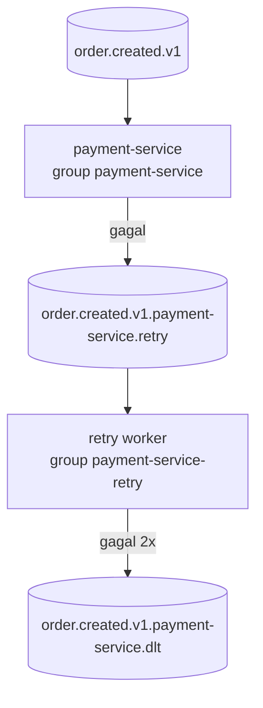

# Lab 06: Idempotency, retry, DLT, dan replay

**Tujuan.** Membuat consumer yang aman terhadap pengiriman ulang: event duplikat diproses sekali, kegagalan sementara dicoba ulang dengan backoff lewat retry topic, pesan yang tetap gagal berakhir di DLT, dan pesan DLT bisa di-replay setelah diperbaiki.

**Waktu:** 60 menit.

Lab ini melanjutkan Lab 05. Semua perintah dijalankan dari `labs/06-idempotency-retry-dlt/solution/`, kecuali perintah `docker compose` yang dijalankan dari akar repo `lab/`.

## Dari mana mulai

- `start/` adalah kerangka yang sudah build dan bisa menjalankan alur normal. Penanda `// LATIHAN:` menunjukkan tiga bagian yang harus ditambahkan: tabel dan klaim `processed_events`, publish retry dan DLT, serta skrip replay.
- `solution/` adalah versi lengkap.

Kalau tertinggal, pakai `solution/` dan ikuti langkah di bawah.

## Topologi yang dipakai



Retry worker adalah proses terpisah dengan consumer group sendiri. Backoff dijalankan dengan `await sleep(...)` di worker itu, jadi pesan yang sedang menunggu tidak menahan consumer utama.

## Prasyarat

Pasang dependensi bersama dan binary native sekali dari akar repo `lab/`:

```bash
cd ../../..          # ke akar repo lab/
npm ci
npm run setup:native
```

`@confluentinc/kafka-javascript` dipakai dari `node_modules` akar; `.npmrc` di akar mematikan install-script karena endpoint rilisnya mengembalikan 504 di sebagian jaringan. Lalu di folder lab ini:

```bash
cd labs/06-idempotency-retry-dlt/solution
npm ci
npm run build
npm run create-topics
```

`create-topics` membuat tiga topic: `order.created.v1`, `...payment-service.retry`, dan `...payment-service.dlt` (3 partisi, RF 3, `min.insync.replicas=2`).

Jalankan tiga proses di tiga terminal:

```bash
# terminal 1
npm run start:payment

# terminal 2
npm run start:retry

# terminal 3
npm run start:order
```

## Langkah

### 1. Dedup: event yang sama diproses sekali

```bash
npm run send:duplicate
```

Script mengirim satu envelope dengan `eventId` yang sama dua kali ke `order.created.v1`, seperti producer yang mengulang kirim.

Periksa:

```bash
cd ../../..          # dari solution/ ke akar repo lab/
docker compose exec postgres psql -U app -d shop \
  -c "select order_id, event_id, amount from payments order by id desc limit 5"
docker compose exec postgres psql -U app -d shop \
  -c "select count(*) from payments where order_id = '<orderId-dari-output-script>'"
```

Hasilnya satu baris. Log payment-service menampilkan `"event":"processed"` untuk pengiriman pertama dan `"event":"duplicate-skipped"` untuk yang kedua. Dedup terjadi di dalam transaksi yang sama dengan insert pembayaran:

```text
BEGIN
  INSERT INTO processed_events (event_id, ...) ON CONFLICT DO NOTHING RETURNING ...
  INSERT INTO payments (...)
COMMIT
```

Kalau `processed_events` sudah berisi `eventId` itu, transaksi tidak menulis pembayaran dan handler tetap meng-commit offset.

### 2. Retry dengan backoff

Lihat header pesan di retry topic setelah satu kegagalan. Setiap percobaan membawa `retry-count` dan `next-retry-at` (epoch milidetik). Worker menunggu sampai waktu itu, lalu memproses lagi. Delay-nya 1 detik lalu 2 detik (`MAX_RETRIES = 2`, `retryDelayMs`).

### 3. Poison message berakhir di DLT

```bash
npm run send:poison
```

Script mengirim envelope valid dengan `amount` 5.000.000, di atas `payment_limits.max_amount` (1.000.000). Pesan tidak bisa berhasil tanpa perubahan konfigurasi, jadi ia berputar di retry topic lalu masuk DLT.

Amati log:

- payment-service: `retry-scheduled` dengan `retryCount: 1`.
- payment-retry: `retry-scheduled` dengan `retryCount: 2`, lalu `dead-lettered`.

Periksa DLT:

```bash
cd ../../..          # dari solution/ ke akar repo lab/
docker compose exec kafka-1 /opt/kafka/bin/kafka-console-consumer.sh \
  --bootstrap-server localhost:29092 \
  --topic order.created.v1.payment-service.dlt \
  --from-beginning --timeout-ms 3000 \
  --formatter-property print.key=true --formatter-property print.headers=true
```

Header di DLT menyimpan `error-message`, `original-topic`, `original-partition`, `original-offset`, dan `retry-count`. Tidak ada baris di `payments` untuk event ini.

### 4. Perbaiki, lalu replay

Penyebabnya keputusan bisnis: batas pembayaran terlalu rendah. Perbaiki datanya, bukan kodenya:

```bash
docker compose exec postgres psql -U app -d shop \
  -c "update payment_limits set max_amount = 10000000 where id = 1"
```

Replay semua isi DLT ke topic asal:

```bash
cd labs/06-idempotency-retry-dlt/solution
npm run replay
```

Script memakai consumer group baru setiap kali, membaca DLT dari awal, membuang header retry, dan menerbitkan ulang ke `original-topic` dengan `eventId` yang sama. Kalau DLT juga berisi insiden lain, filter ke satu event:

```bash
npm run replay -- --event-id <eventId>
```

Setelah beberapa detik, periksa:

```bash
docker compose exec postgres psql -U app -d shop \
  -c "select event_id, order_id, amount from payments where event_id = '<eventId>'"
```

Tepat satu baris. Jalankan `npm run replay` sekali lagi: masih satu baris, karena `processed_events` sudah mencatat `eventId` itu.

### 5. Baca ulang kode yang penting

- `src/payment-service/payment.service.ts`: klaim `event_id` dan efek pembayaran dalam satu transaksi Postgres.
- `src/payment-service/payment.controller.ts`: publish ke retry lalu commit; publish dulu, commit kemudian.
- `src/payment-service/retry.controller.ts`: header backoff, `MAX_RETRIES`, DLT.
- `src/payment-service/kafka-helpers.ts`: commit manual dan validasi kontrak.
- `scripts/replay-dlt.js`: prosedur replay manual.

Kalau proses mati setelah publish retry tetapi sebelum commit, pesan asli dikirim ulang. Retry ganda itu tidak berbahaya karena `eventId` yang sama hanya diproses sekali. Ini alasan dedup dan retry harus dipakai bersama.

## Selesai jika

Pesan duplikat hanya menghasilkan satu baris pembayaran, pesan yang tidak bisa diproses berakhir di DLT, dan replay setelah perbaikan memproses pesan itu tepat sekali (replay kedua tidak menambah baris).
