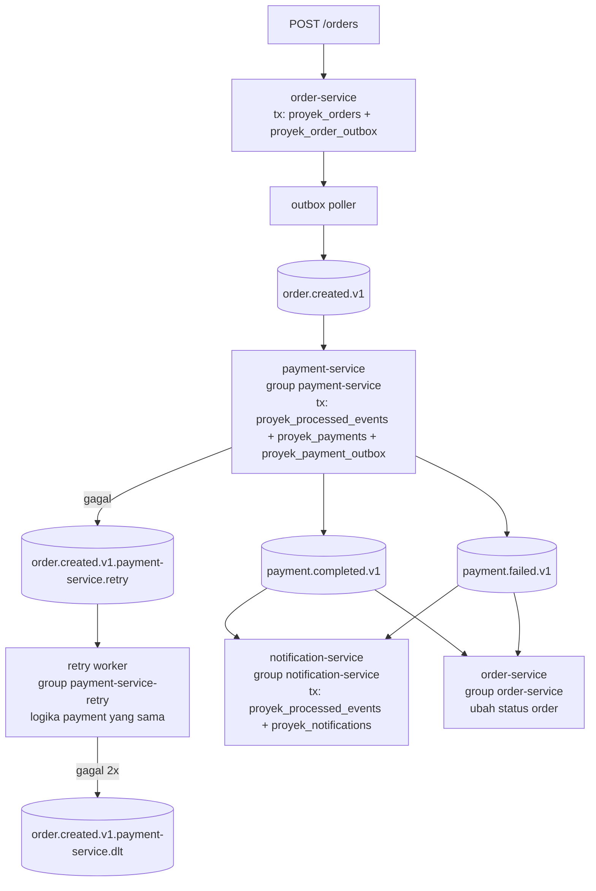

# Mini-proyek: order, payment, notification

> **Latihan mandiri, opsional.** Proyek ini tidak dikerjakan di kelas dan bukan kewajiban. Di kelas (sesi 12), trainer mendemokan `solution/`. Kerjakan `start/` setelah training kalau ingin berlatih sendiri.

**Tujuan.** Merangkai tiga service NestJS menjadi satu alur yang tahan kegagalan: order diterima lewat HTTP, event-nya keluar lewat outbox, pembayaran idempotent dengan retry dan DLT, dan notifikasi disimpan di Postgres. Semua skenario fault injection harus berakhir dengan status order yang benar.

**Waktu:** 75 menit.

## Dari mana mulai

- `start/` adalah kerangka tiga service. Ia sudah build dan ketiga service bisa dinyalakan, tetapi alur normal baru lengkap setelah enam `// LATIHAN:` diisi: baris outbox order, publish outbox poller, klaim event dan outbox pembayaran, retry payment, penerusan retry ke DLT, dan dedup notification.
- `solution/` adalah versi lengkap dan dipakai untuk demo.

Perintah di bawah dijalankan dari `proyek/solution/` (atau `proyek/start/`).

## Arsitektur



- Outbox: perubahan bisnis dan event keluar ditulis dalam satu transaksi Postgres. Tidak ada dual-write.
- Idempotent consumer: pasangan `(consumer_group, event_id)` diklaim di `proyek_processed_events` dalam transaksi yang sama dengan efeknya. Tabel ini dipakai bersama payment-service dan notification-service; `consumer_group` di primary key membuat klaim satu service tidak menghalangi service lain memproses event yang sama. Retry worker memakai klaim group `payment-service`, karena ia menjalankan logika payment yang sama.
- Retry/DLT: kegagalan dipindah ke `order.created.v1.payment-service.retry` dengan header backoff, lalu ke `...dlt` setelah 2 percobaan.
- Notifikasi disimpan di tabel `proyek_notifications`, bukan dikirim sungguhan.
- Semua tabel proyek memakai prefix `proyek_` supaya tidak bentrok dengan tabel lab lain di database `shop` yang sama.

## Prasyarat

Dari akar repo `lab/`, pasang dependensi bersama dan binary native sekali:

```bash
cd ../..             # dari proyek/solution ke akar repo lab/
npm ci
npm run setup:native
```

`.npmrc` di akar mematikan install-script karena endpoint unduhan rilis `@confluentinc/kafka-javascript` mengembalikan 504 di sebagian jaringan; `setup:native` mengunduh binary-nya lewat GitHub API. Paket itu dipakai dari `node_modules` akar.

Lalu di folder ini:

```bash
cd proyek/solution
npm ci
npm run build
docker compose -f ../../docker-compose.yml up -d   # compose file ada di akar repo lab/
npm run create-topics
```

Topic yang dibuat: `order.created.v1`, `payment.completed.v1`, `payment.failed.v1`, retry, dan DLT (3 partisi, RF 3).

Kalau proyek ini pernah dijalankan sebelum kolom `consumer_group` ditambahkan, tabel `proyek_processed_events` versi lama masih ada dan `CREATE TABLE IF NOT EXISTS` tidak mengubahnya; service tetap menyala, tetapi setiap event gagal dengan `column "consumer_group" of relation "proyek_processed_events" does not exist` lalu masuk retry dan DLT. Hapus tabel itu sekali sebelum menyalakan service:

```bash
docker compose -f ../../docker-compose.yml exec postgres psql -U app -d shop -c "drop table if exists proyek_processed_events"
```

Atau mulai dari stack kosong dengan `docker compose -f ../../docker-compose.yml down -v` lalu `up -d` (ini menghapus seluruh data lab lain juga).

## Menjalankan

```bash
scripts/start-all.sh
```

Script menjalankan empat proses di latar belakang (order 3000, payment 3001, notification 3002, retry worker), menulis log dan PID ke `.run/`. Hentikan dengan:

```bash
scripts/stop-all.sh
```

Kirim satu order dan periksa hasilnya:

```bash
curl -s -X POST localhost:3000/orders \
  -H 'content-type: application/json' \
  -H 'x-correlation-id: demo-1' \
  -d '{"customerId":"cust-1","amount":125000,"currency":"IDR"}'

curl -s localhost:3000/orders/<orderId>

cd ../..
docker compose exec postgres psql -U app -d shop \
  -c "select order_id, event_type, message from proyek_notifications order by id desc limit 3"
```

Status order berubah `PENDING` → `PAID` setelah payment selesai. `amount` di atas 1.000.000 menghasilkan `FAILED` (payment.failed.v1).

## Skenario fault injection

Jalankan `scripts/start-all.sh` lebih dulu. Setiap script mencetak `OK` atau `FAIL` dan berhenti dengan exit code bukan nol kalau ada yang salah.

| Script | Yang di-inject | Hasil yang harus terlihat |
|---|---|---|
| `scripts/fault-consumer-crash.sh` | `kill -9` payment saat memproses pesan | Order tetap `PAID`, satu baris `proyek_payments`, satu `proyek_notifications` |
| `scripts/fault-duplicate.sh` | Event yang sama dikirim dua kali | Satu baris `proyek_payments`, satu `proyek_notifications` |
| `scripts/fault-poison.sh` | Envelope valid dengan `amount` negatif | Pesan ada di DLT, tidak ada baris `proyek_payments` |
| `scripts/fault-broker-down.sh` | Ketiga broker dimatikan saat order masuk | Order tersimpan `PENDING`, outbox terkirim setelah broker hidup, order jadi `PAID` |

Contoh:

```bash
scripts/fault-consumer-crash.sh
scripts/fault-duplicate.sh
scripts/fault-poison.sh
scripts/fault-broker-down.sh
```

`fault-broker-down.sh` memakai Docker Compose, jadi jangan dijalankan bersamaan dengan tim lain yang sedang memakai cluster yang sama.

## Integration test

```bash
npm test
```

Test menyalakan Kafka dan Postgres sendiri lewat Testcontainers (`confluentinc/cp-kafka:8.4.1` dan `postgres:17`), membuat topic dengan replication factor 1, lalu menjalankan alur lengkap: order `PAID`, duplikat tidak menambah baris, pesan rusak masuk DLT, dan (di `solution/`) order dengan `amount` di atas limit menjadi `FAILED`. Docker harus menyala dan image sudah pernah di-pull; bagian pertama bisa memakan 30–60 detik.

Di `start/`, test yang sama baru lulus setelah seluruh `// LATIHAN:` diisi. Sebelum itu ia berhenti di pemeriksaan order `PAID`.

### Tugas: tambah satu kasus uji

Test yang ada baru menguji jalur sukses, duplikat, dan pesan rusak. Jalur `payment.failed.v1` belum diuji. Tambahkan kasus keempat di `test/integration.test.js`, di tempat bertanda `// LATIHAN 7` (setelah bagian 3, sebelum `finally`).

Acuan: bagian `// --- 1. happy path` di berkas yang sama. Polanya sama, hanya hasilnya yang berbeda:

1. `POST /orders` dengan `amount` 2000000 (di atas `PAYMENT_LIMIT` 1.000.000). Respons harus `202`.
2. Tunggu `GET /orders/<orderId>` berstatus `FAILED` memakai helper `waitFor`.
3. Tepat satu baris `proyek_payments` untuk order itu, dengan `status` `failed`.
4. Tepat satu baris `proyek_notifications` untuk order itu, dengan `event_type` `payment.failed.v1` (konstanta `PAYMENT_FAILED`) dan `message` yang memuat `gagal`.

Jalankan dari `proyek/start/` (atau folder tempat kamu bekerja):

```bash
npm test
```

Kasus baru dijalankan di dalam test yang sama, jadi Kafka dan Postgres tidak dinyalakan ulang. Hasil yang diharapkan tetap `pass 1`, `fail 0`. Untuk memastikan kasus barunya benar-benar memeriksa sesuatu, ubah sementara `'FAILED'` menjadi `'PAID'` di `waitFor`; test harus gagal dengan `timeout menunggu order FAILED` setelah 30 detik. Jawaban ada di `solution/test/integration.test.js`, bagian `// --- 4.`

## Selesai jika

Keempat skenario fault berakhir dengan status order yang benar, kasus uji `FAILED` sudah ditambahkan, dan `npm test` lulus.
